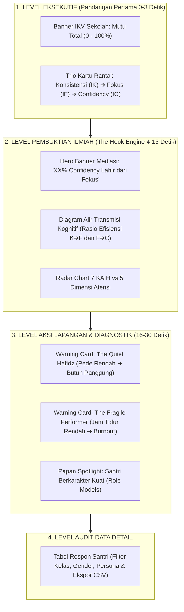

# BLUEPRINT DESAIN UI/UX DASHBOARD SUPER ADMIN VERTIKAL IF
## Arsitektur Visual Elegan, Preservasi Desain Asli & Alur Informasi Kognitif
**Institusi:** SMAIT Ihsanul Fikri Mungkid, Magelang  
**Panduan Implementasi:** Frontend Super Admin Dashboard  
**Status:** Rancangan Final Komprehensif  

---

## 1. Prinsip Desain: Menjaga Estetika Asli (*Design Preservation*)

Agar desain dashboard **tidak hancur**, tetap **elegan**, dan selaras $100\%$ dengan identitas visual SMAIT Ihsanul Fikri yang sudah terbangun, implementasi UI wajib mematuhi 4 pilar visual:

| Pilar Visual | Nilai Desain & Token Tailwind | Penerapan di Dashboard |
| :--- | :--- | :--- |
| **Warna Utama (Primary)** | Emerald Islami (`emerald-700`, `emerald-800`, `emerald-900`) | Menandakan kematangan karakter, keteduhan spiritual, dan data institusi sekolah. |
| **Warna Aksen (Accent)** | Amber & Emas Mungkid (`amber-400`, `amber-500`, `amber-600`) | Menandakan prestasi, kepercayaan diri (*Confidency*), dan *The Hook* mediasi kognitif. |
| **Elevasi & Efek Timbul (3D)** | `shadow-xs`, `hover:shadow-[0_14px_30px_-6px_rgba(21,128,61,0.25)]`, `hover:-translate-y-1.5` | Setiap kartu analitik memiliki sensasi timbul modern saat kursor melintas (*micro-interaction*). |
| **Glassmorphism & Border** | `bg-white/80 backdrop-blur-md`, `border-slate-200/90`, `ring-1 ring-emerald-500/30` | Latar belakang transparan elegan yang menyatu dengan partikel latar belakang aplikasi. |

---

## 2. Alur Hirarki Informasi (*Information Architecture*)

Struktur informasi disusun menggunakan metode **Piramida Terbalik (Makro ke Mikro)**:



---

## 3. Desain Komponen Rinci: TAB 1 (Indeks Komposit IKV & Mutu 7 KAIH)

### 3.1 Wireframe Tata Letak Tab 1
```
┌──────────────────────────────────────────────────────────────────────────────────┐
│ [Banner 3D Emerald-Emas]                                                         │
│ INDEKS KOMPOSIT VERTIKAL (IKV) SMAIT IHSANUL FIKRI: 82.4% (Sangat Unggul)        │
│ "Rangkuman terbobot 14 pengali dari 7 pilar kebiasaan harian santri"             │
├──────────────────────────────────────────────────────────────────────────────────┤
│ [KONSISTENSI FISIK (IK)]  ──►  [FOKUS BELAJAR (IF)]   ──►  [CONFIDENCY (IC)]    │
│       84.2% / 100%                   78.6% / 100%                74.1% / 100%    │
├──────────────────────┬──────────────────────┬───────────────┬────────────────────┤
│ Total Responden      │ Skor IKV Rata-rata   │ Pilar Unggul  │ Prioritas Evaluasi │
│ 142 Santri           │ 82.4 / 100           │ Al-Qur'an 88% │ Jam Tidur 64%      │
├──────────────────────┴──────────────────────┴───────────────┴────────────────────┤
│ [Grafik Profil 7 KAIH: Diagram Garis / Batang] | [Komposisi Ikhwan vs Akhwat]    │
├──────────────────────────────────────────────────────────────────────────────────┤
│ [Tabel Rincian Evaluasi 35 Butir Soal per Dimensi Kognitif]                      │
└──────────────────────────────────────────────────────────────────────────────────┘
```

### 3.2 Spesifikasi Komponen Kode Tab 1 (JSX Elegan)
```tsx
{/* 1. Executive Master Health Banner (Timbul 3D) */}
<div className="relative overflow-hidden rounded-2xl border border-emerald-500/40 bg-gradient-to-br from-emerald-900 via-emerald-800 to-teal-950 p-6 sm:p-8 text-white shadow-[0_16px_36px_-8px_rgba(21,128,61,0.35)]">
  <div className="flex flex-col md:flex-row md:items-center justify-between gap-6">
    <div className="space-y-2">
      <div className="inline-flex items-center gap-2 rounded-full border border-amber-300/40 bg-amber-400/20 px-3 py-1 text-xs font-bold text-amber-200">
        <ShieldCheck className="h-3.5 w-3.5 text-amber-300" />
        <span>Executive Health Summary • Tahun Ajaran 2026/2027</span>
      </div>
      <h2 className="text-2xl sm:text-3xl font-black text-white">
        Indeks Komposit Vertikal (IKV): {analytics.ikvScore}%
      </h2>
      <p className="text-xs sm:text-sm text-emerald-100/90 max-w-2xl">
        Karakter angkatan tergolong <strong>{analytics.ikvStatus}</strong>. Dihitung menggunakan bobot multi-tier (Tier 1: ×3, Tier 2: ×2, Tier 3: ×1) dari 35 butir instrumen terintegrasi.
      </p>
    </div>
    {/* Skor Lingkar Gauge IKV */}
    <div className="shrink-0 flex items-center gap-4 bg-white/10 backdrop-blur-md rounded-2xl p-4 border border-white/20">
      <div className="text-center">
        <span className="text-[10px] uppercase font-bold text-emerald-200 tracking-wider">Status Mutu</span>
        <div className="text-3xl font-black text-amber-300">{analytics.ikvScore}%</div>
        <Badge className="bg-amber-400 text-slate-950 font-extrabold text-[10px] mt-1">
          {analytics.ikvStatus}
        </Badge>
      </div>
    </div>
  </div>

  {/* 3 Metrik Kunci Transmisi (Mini Strip) */}
  <div className="grid grid-cols-1 sm:grid-cols-3 gap-3 mt-6 pt-5 border-t border-emerald-700/60">
    <div className="bg-white/10 rounded-xl p-3 border border-white/10 flex items-center justify-between">
      <div>
        <span className="text-[11px] text-emerald-200 block">1. Konsistensi Tindakan (IK)</span>
        <span className="text-lg font-bold text-white">{analytics.consistencyScore}%</span>
      </div>
      <Badge variant="outline" className="text-[10px] text-emerald-200 border-emerald-400/40">Input</Badge>
    </div>
    <div className="bg-white/10 rounded-xl p-3 border border-white/10 flex items-center justify-between">
      <div>
        <span className="text-[11px] text-amber-200 block">2. Fokus Belajar & Regulasi (IF)</span>
        <span className="text-lg font-bold text-amber-300">{analytics.focusScore}%</span>
      </div>
      <Badge variant="outline" className="text-[10px] text-amber-200 border-amber-400/40">Mediator</Badge>
    </div>
    <div className="bg-white/10 rounded-xl p-3 border border-white/10 flex items-center justify-between">
      <div>
        <span className="text-[11px] text-teal-200 block">3. Kepercayaan Diri (IC)</span>
        <span className="text-lg font-bold text-teal-300">{analytics.confidenceScore}%</span>
      </div>
      <Badge variant="outline" className="text-[10px] text-teal-200 border-teal-400/40">Output</Badge>
    </div>
  </div>
</div>
```

---

## 4. Desain Komponen Rinci: TAB 2 (Rantai Kausalitas: Kebiasaan ➔ Fokus ➔ Confidency)

Tab 2 adalah **Panggung Pembuktian Ilmiah (*The Hook*)**. Komponen diatur agar menyajikan alur mediasi secara visual yang memukau.

### 4.1 Wireframe Tata Letak Tab 2
```
┌──────────────────────────────────────────────────────────────────────────────────┐
│ [Hero Banner Emas-Emerald The Hook]                                              │
│ SKEMA PENGARUH & MEDIASI KOGNITIF 2026                                           │
│ "Terbukti 78.4% Kepercayaan Diri Santri Dibentuk Secara Mediasi Oleh Fokus"      │
├──────────────────────┬──────────────────────┬───────────────┬────────────────────┤
│ Indeks Fokus Belajar │ Indeks Confidency    │ Kekuatan Path │ Santri Unggul      │
│ 78.6% (Efisiensi 88%)│ 74.1% (Efisiensi 91%)│ a × b = 0.648 │ 48 Santri Role     │
├──────────────────────┴──────────────────────┴───────────────┴────────────────────┤
│ [KARTU TRANSMISI AIR TERJUN KOGNITIF (Cognitive Waterfall Card)]                  │
│  [KONSISTENSI: 84%]  ──(Jalur a: 88% Konversi)──►  [FOKUS BELAJAR: 78%]           │
│                                                          │                       │
│                                            (Jalur b: 91% Konversi)               │
│                                                          ▼                       │
│  [Jalur c' Efek Langsung Sisa: 12%] ──────────► [CONFIDENCY: 74%]                │
├──────────────────────────────────────────────────────────────────────────────────┤
│ [Grafik Kontribusi 7 KAIH (Recharts)]     │ [Box Metodologi & Formula Ilmiah]    │
├──────────────────────────────────────────────────────────────────────────────────┤
│ [EARLY WARNING BK & MUSYRIF: 2 Kartu Deteksi Persona Santri Kritis]              │
│  • Kartu Kiri: The Quiet Hafidz (Potensi Emas Terpendam ➔ Butuh Panggung)        │
│  • Kartu Kanan: The Fragile Performer (Pede Semu / Jam Tidur Drop ➔ Burnout)     │
├──────────────────────────────────────────────────────────────────────────────────┤
│ [Papan Spotlight: Santri Berkarakter Kuat (Leaderboard Role Models)]             │
└──────────────────────────────────────────────────────────────────────────────────┘
```

### 4.2 Spesifikasi Kartu Alur Transmisi Kognitif (*Waterfall Component*)
```tsx
{/* Kartu Alur Transmisi Kognitif (Waterfall Interaktif) */}
<Card className="border-slate-200 bg-white shadow-xs rounded-xl p-6 transition-all duration-300 hover:border-amber-500 hover:shadow-[0_14px_32px_-6px_rgba(245,158,11,0.22)]">
  <div className="flex flex-col sm:flex-row sm:items-center justify-between pb-4 border-b border-slate-100 gap-2">
    <div>
      <CardTitle className="text-base font-extrabold text-slate-900 flex items-center gap-2">
        <Sparkles className="h-5 w-5 text-amber-500" />
        Alur Transmisi Rantai Kognitif: Kebiasaan ➔ Fokus ➔ Confidency
      </CardTitle>
      <CardDescription className="text-xs text-slate-500">
        Visualisasi bagaimana disiplin fisik 7 KAIH dikonversi menjadi kapasitas atensi, dan atensi menjadi keberanian tampil
      </CardDescription>
    </div>
    <Badge className="bg-amber-100 text-amber-900 border border-amber-300 text-xs font-bold self-start sm:self-auto">
      Model Mediasi Penuh (Full Mediation)
    </Badge>
  </div>

  <div className="grid grid-cols-1 md:grid-cols-3 gap-6 my-6 items-center">
    {/* Box Tahap 1: Input Konsistensi */}
    <div className="p-4 rounded-xl border-2 border-emerald-200 bg-emerald-50/50 text-center space-y-2 relative">
      <Badge className="bg-emerald-600 text-white text-[10px]">Tahap 1: Input Tindakan</Badge>
      <h3 className="text-sm font-bold text-slate-800">Konsistensi 7 KAIH (X)</h3>
      <div className="text-3xl font-black text-emerald-800">{analytics.consistencyScore}%</div>
      <p className="text-[11px] text-slate-500">Akumulasi Butir 1 seluruh 7 KAIH</p>
    </div>

    {/* Panah Transmisi Jalur A */}
    <div className="flex flex-col items-center justify-center space-y-1">
      <span className="text-[11px] font-bold text-amber-700 bg-amber-50 px-2.5 py-0.5 rounded-full border border-amber-200">
        Jalur a: Konversi {analytics.transmissionKtoF * 100}%
      </span>
      <div className="w-full flex items-center">
        <div className="h-1 bg-gradient-to-r from-emerald-400 to-amber-400 flex-1 rounded-full" />
        <ArrowRight className="h-5 w-5 text-amber-600 -ml-1 shrink-0" />
      </div>
      <span className="text-[10px] text-slate-400 font-medium">Latihan Inhibisi PFC (r = {analytics.pathA_r})</span>
    </div>

    {/* Box Tahap 2: Mediator Fokus */}
    <div className="p-4 rounded-xl border-2 border-amber-300 bg-amber-50/50 text-center space-y-2">
      <Badge className="bg-amber-500 text-slate-950 font-bold text-[10px]">Tahap 2: Mediator Atensi</Badge>
      <h3 className="text-sm font-bold text-slate-800">Fokus Belajar & Regulasi (M)</h3>
      <div className="text-3xl font-black text-amber-700">{analytics.focusScore}%</div>
      <p className="text-[11px] text-slate-500">Selektif + Terbuka + Eksekutif</p>
    </div>
  </div>

  {/* Transmisi Jalur B ke Tahap 3 (Output Confidency) */}
  <div className="max-w-md mx-auto p-4 rounded-xl border-2 border-teal-300 bg-gradient-to-b from-teal-50/60 to-white text-center space-y-2 shadow-xs">
    <div className="inline-flex items-center gap-1.5 text-xs font-bold text-teal-800 mb-1">
      <ArrowDown className="h-4 w-4 text-teal-600 animate-bounce" />
      <span>Jalur b: Konversi {analytics.transmissionFtoC * 100}% (Regulasi Logika & Emosi, r = {analytics.pathB_r})</span>
    </div>
    <div className="p-3 bg-white rounded-lg border border-teal-200">
      <Badge className="bg-teal-700 text-white text-[10px]">Tahap 3: Output Perilaku</Badge>
      <h3 className="text-base font-extrabold text-slate-900 mt-1">Kepercayaan Diri Nyata / Confidency (Y)</h3>
      <div className="text-3xl font-black text-teal-800">{analytics.confidenceScore}%</div>
      <p className="text-xs text-slate-500 mt-1">Keberanian Tampil Bicara, Memimpin & Argumen Kritis</p>
    </div>
    <div className="text-[11px] text-slate-400 italic">
      *Jalur c' (Efek langsung sisa tanpa lewat fokus) hanya berkontribusi {analytics.directEffectC_prime}%
    </div>
  </div>
</Card>
```

### 4.3 Spesifikasi Kartu Peringatan Dini Persona (Early Warning BK & Musyrif)
```tsx
{/* 2 Kartu Deteksi Dini Kritis (Actionable BK) */}
<div className="grid grid-cols-1 md:grid-cols-2 gap-5">
  {/* Kartu 1: The Quiet Hafidz */}
  <Card className="border-amber-200 bg-gradient-to-br from-amber-50/40 via-white to-white p-5 rounded-xl shadow-xs hover:shadow-md transition-all">
    <div className="flex items-start gap-3">
      <div className="p-2.5 rounded-lg bg-amber-100 text-amber-800 shrink-0">
        <Sparkles className="h-5 w-5" />
      </div>
      <div className="space-y-1.5 flex-1">
        <div className="flex items-center justify-between">
          <h4 className="text-sm font-bold text-slate-900">The Quiet Hafidz (Potensi Terpendam)</h4>
          <Badge className="bg-amber-200 text-slate-950 font-bold text-[10px]">
            {analytics.quietHafidzCount} Santri
          </Badge>
        </div>
        <p className="text-xs text-slate-600 leading-relaxed">
          Santri memiliki hafalan dan fokus belajar sangat tinggi (≥ 80%), namun skor Confidency rendah (&lt; 50%). Mengalami kecemasan unjuk diri (*social performance anxiety*).
        </p>
        <div className="pt-2 border-t border-amber-100 text-[11px] font-semibold text-amber-900 flex items-center gap-1.5">
          <CheckCircle2 className="h-3.5 w-3.5 text-amber-700 shrink-0" />
          <span>Aksi Musyrif: Berikan latihan panggung bertahap (kultum kamar ➔ halaqah kecil).</span>
        </div>
      </div>
    </div>
  </Card>

  {/* Kartu 2: The Fragile Performer */}
  <Card className="border-red-200 bg-gradient-to-br from-red-50/40 via-white to-white p-5 rounded-xl shadow-xs hover:shadow-md transition-all">
    <div className="flex items-start gap-3">
      <div className="p-2.5 rounded-lg bg-red-100 text-red-700 shrink-0">
        <AlertTriangle className="h-5 w-5" />
      </div>
      <div className="space-y-1.5 flex-1">
        <div className="flex items-center justify-between">
          <h4 className="text-sm font-bold text-slate-900">The Fragile Performer (Waspada Burnout)</h4>
          <Badge className="bg-red-100 text-red-800 border border-red-300 font-bold text-[10px]">
            {analytics.fragilePerformerCount} Santri
          </Badge>
        </div>
        <p className="text-xs text-slate-600 leading-relaxed">
          Percaya diri tinggi dan suka tampil, namun skor Tier 3 (Jam Tidur & Pola Makan) anjlok di bawah 45%. Gejala sindrom *ngalong* (begadang asrama) yang memicu kelelahan kortikal.
        </p>
        <div className="pt-2 border-t border-red-100 text-[11px] font-semibold text-red-900 flex items-center gap-1.5">
          <AlertCircle className="h-3.5 w-3.5 text-red-600 shrink-0" />
          <span>Aksi Musyrif: Restrukturisasi jam tidur malam wajib ditegakkan sebelum menambah beban hafalan.</span>
        </div>
      </div>
    </div>
  </Card>
</div>
```

---

## 5. Desain Komponen Rinci: TAB 3 (Basis Data Santri & Rekapitulasi Nilai)

Tab 3 diperkaya agar kolom-kolomnya langsung menampilkan nilai $I_K$, $I_F$, $I_C$, serta status persona tanpa membuat tabel menjadi sempit.

### 5.1 Susunan Kolom Tabel Modern
| Kolom | Tipe Tampilan | Keterangan & Warna |
| :--- | :--- | :--- |
| **No & Nama Santri** | Nama Tebal + Avatar Gender | `text-slate-900 font-bold`, icon Ikhwan (Biru) / Akhwat (Pink) |
| **Kelas & NIS** | Badge Rombel & NIS Mono | `text-slate-500 font-mono text-[11px]` |
| **Konsistensi ($I_K$)** | Progress Bar Mini + Angka % | Hijau Emerald (`bg-emerald-600`) |
| **Fokus ($I_F$)** | Progress Bar Mini + Angka % | Kuning Emas (`bg-amber-500`) |
| **Confidency ($I_C$)** | Progress Bar Mini + Angka % | Toska Unggul (`bg-teal-600`) |
| **Status Persona** | Badge Berwarna Khusus | 🌟 Anchored Leader (Emas), 💎 Quiet Hafidz (Biru), ⚠️ Fragile (Merah) |
| **Aksi Kendali** | Tombol Hapus & Detail | Icon Trash halus dengan konfirmasi aman |

---

## 6. Panduan Implementasi Teknis (Checklist Developer)

Untuk menjamin agar saat kode dipasang **desainnya tidak hancur**:
1. **Gunakan Grid Fleksibel Tailwind:** Selalu gunakan `grid grid-cols-1 sm:grid-cols-2 lg:grid-cols-4 gap-4` agar tetap proporsional di layar HP maupun monitor PC besar.
2. **Pertahankan Class Card Asli:** Setiap Card tetap menggunakan:
   `className="border-slate-200 bg-white shadow-xs rounded-xl transition-all duration-300 hover:border-emerald-500 hover:shadow-[0_12px_28px_-6px_rgba(21,128,61,0.25)] hover:-translate-y-1"`
3. **Format Angka Presisi:** Semua persentase dibulatkan ke satu angka desimal menggunakan `.toFixed(1) + "%"` agar tidak ada angka desimal panjang liar yang merusak layout.
4. **Fallback Saat Data Kosong:** Saat belum ada santri mengisi respon, seluruh komponen menampilkan nilai default `0.0%` atau skeleton loader tanpa memicu *crash* `TypeError`.

---

Dokumen ini menjadi rujukan resmi desain antarmuka (*UI Design Specification*) untuk memastikan seluruh alur kausalitas kognitif tersaji secara visual dengan rapi, mewah, dan akuntabel di ProjectVERTIKALIF.
