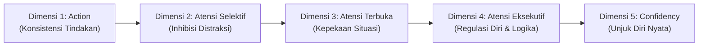
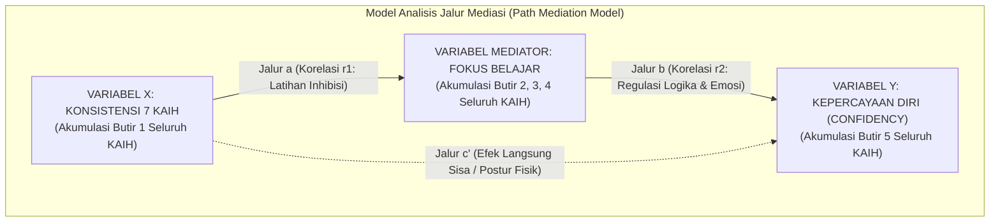

# SKEMA PERHITUNGAN & ARSITEKTUR KOGNITIF DIAGNOSTIK VERTIKAL IF
## Pengukuran Terintegrasi 7 KAIH, Sistem Atensi Kognitif, dan Kepercayaan Diri (*Confidency*)
**Institusi:** SMAIT Ihsanul Fikri Mungkid, Magelang  
**Versi Dokumen:** 2.0 (Edisi Standar Final Evaluasi)  
**Tanggal:** 1 November 2026  

---

## 1. Landasan Teori & Tesis Utama (*The Hook*)

### 1.1 Mematahkan Paradigma Lama
Selama ini, kepercayaan diri (*self-confidence*) pada remaja sering disalahpahami sebagai bakat lahiriah (*fixed trait*) atau hasil doktrinasi motivasi instan (*"Kamu pasti bisa!"*). Paradigma ini terbukti rapuh: santri yang diberi suntikan motivasi instan mudah gugup dan *blank* ketika menghadapi audiens kritis, soal ujian rumit, atau perdebatan terbuka.

### 1.2 Tesis Utama VERTIKAL IF
```
[ TESIS UTAMA PROGRAM VERTIKAL SMAIT IHSANUL FIKRI ]
7 Kebiasaan Harian          Sistem Atensi &              Kepercayaan Diri
   (7 KAIH)          ───►   Regulasi Kognitif    ───►       (Confidency)
[KONSISTENSI FISIK]          [FOKUS BELAJAR]              [UNJUK DIRI NYATA]
```

1. **Confidency adalah Luaran Fungsional (*Behavioral Output*):**  
   Rasa percaya diri sejati yang kokoh (*anchored confidence*) merupakan hasil alami dari kapasitas **Atensi Eksekutif (*Executive Attention*)** dan regulasi kendali diri di korteks prefrontal (*Prefrontal Cortex* / PFC).
2. **Peran Neurobiologis PFC vs Amigdala:**  
   Ketika santri harus berbicara di mimbar atau di depan forum musyawarah, amigdala (pusat respon takut/cemas) akan terpicu secara biologis. Santri yang terlatih atensi eksekutifnya mampu mengirimkan sinyal inhibisi *top-down* dari PFC untuk menenangkan amigdala, menata kembali urutan logika, dan mempertahankan kontak mata secara mantap.
3. **7 KAIH sebagai Beban Latihan (*Cognitive Training Load*):**  
   7 Kebiasaan Anak Indonesia Hebat (Bangun Pagi, Beribadah, Gemar Membaca, Olahraga, Makan Sehat, Bermasyarakat, Istirahat Cukup) bukan sekadar rutinitas formalitas. Setiap kebiasaan adalah unit latihan harian yang secara konstan menuntut kendali inhibisi:
   - Bangun dini hari menuntut inhibisi kantuk.
   - Membaca buku teks mendalam menuntut inhibisi godaan mengobrol.
   - Puasa & adab makan menuntut penundaan kepuasan (*delayed gratification*).

---

## 2. Arsitektur Rantai Kognitif 5 Dimensi (*The 5-Stage Cognitive Pipeline*)

Setiap satu kebiasaan dalam 7 KAIH diukur melalui **5 butir pertanyaan terstruktur** yang membentuk pipa transmisi kognitif linier:



| Dimensi | Nomor Butir | Aspek yang Diukur | Definisi Operasional |
| :--- | :---: | :--- | :--- |
| **Dimensi 1: Action** | Butir 1 | Konsistensi Tindakan Fisik | Mengukur frekuensi dan kepatuhan riil terhadap rutinitas fisik harian di asrama/sekolah. |
| **Dimensi 2: Atensi Selektif** | Butir 2 | Fokus Sempit (*Selective Focus*) & Inhibisi | Kapasitas menyaring (*filter*) gangguan eksternal (suara teman) maupun internal (kantuk, jenuh). |
| **Dimensi 3: Atensi Terbuka** | Butir 3 | Fokus Luas (*Open Monitoring*) & Wawasan | Kesiagaan mental membaca situasi sosial, mengaitkan konsep ilmu, dan kesadaran interoseptif tubuh. |
| **Dimensi 4: Atensi Eksekutif** | Butir 4 | Regulasi Diri (*Executive Control*) | Kapasitas menahan impuls emosi, merumuskan alur argumen logis, dan manajemen prioritas di bawah tekanan. |
| **Dimensi 5: Confidency** | Butir 5 | Unjuk Diri Nyata (*Observable Output*) | Keberanian nyata: mengangkat tangan berargumen, memimpin musyawarah santri, dan tampil tenang di panggung. |

---

## 3. Formulasi Skoring & Normalisasi Matematis

### 3.1 Skala Pilihan Jawaban (Likert 4 Poin)
Setiap butir soal memiliki 4 opsi jawaban:
- **[ 1 ] Sangat Tidak Sesuai / Sangat Jarang**
- **[ 2 ] Kurang Sesuai / Kadang-Kadang**
- **[ 3 ] Sesuai / Sering**
- **[ 4 ] Sangat Sesuai / Selalu Konsisten**

### 3.2 Normalisasi Skor per Butir Soal ($0\% - 20\%$)
Sesuai rancangan bahwa **1 KAIH bernilai total 100%** dan terdiri dari **5 soal dengan porsi seimbang 20% per soal**:
Untuk memastikan batas bawah murni $0\%$ saat memilih opsi 1 dan batas atas $20\%$ saat memilih opsi 4, digunakan rumus *Min-Max Normalization*:

$$s(q_{i,j}) = \left( \frac{\text{Opsi}_{i,j} - 1}{4 - 1} \right) \times 20\% = \left( \frac{\text{Opsi}_{i,j} - 1}{3} \right) \times 20\%$$

*Tabel Konversi Poin per Butir Soal:*
- Opsi 1 $\longrightarrow 0.00\%$
- Opsi 2 $\longrightarrow 6.67\%$
- Opsi 3 $\longrightarrow 13.33\%$
- Opsi 4 $\longrightarrow 20.00\%$

### 3.3 Skor Total Satu KAIH ($K_i$)
Skor total untuk KAIH ke-$i$ (maksimum $100\%$):
$$K_i = \sum_{j=1}^{5} s(q_{i,j}) = s(q_{i,1}) + s(q_{i,2}) + s(q_{i,3}) + s(q_{i,4}) + s(q_{i,5})$$

---

## 4. Sistem Pembobotan Multi-Tier & Indeks Komposit Vertikal ($IKV$)

Untuk menghindari bias bahwa semua kebiasaan berbobot sama rata, diterapkan sistem pembobotan berjenjang (*Multi-Tier Weighting*):

| Kategori Tier | Kebiasaan (KAIH) Terkait | Bobot ($W_i$) | Porsi Kontribusi Relatif | Alasan Metodologis |
| :--- | :--- | :---: | :---: | :--- |
| **Tier 1 (Modal Utama)** | • KAIH 1: Gemar Membaca & Riset<br>• KAIH 2: Bermasyarakat & Adab | $\mathbf{\times 3}$ | $\mathbf{42.86\%}$ | Daya ungkit langsung (*high leverage*) terhadap penguasaan argumen, literasi, dan kepemimpinan publik. |
| **Tier 2 (Pengendali Diri)** | • KAIH 3: Bangun Pagi & Qiyamul Lail<br>• KAIH 4: Ibadah & Al-Qur'an<br>• KAIH 5: Olahraga & Kebugaran | $\mathbf{\times 2}$ | $\mathbf{42.86\%}$ | Penstabil ritme sirkadian, penempa ketahanan mental, dan jangkar spiritual di bawah tekanan. |
| **Tier 3 (Fondasi Biologis)** | • KAIH 6: Istirahat Teratur & Jam Tidur<br>• KAIH 7: Makan Sehat & Gizi Seimbang | $\mathbf{\times 1}$ | $\mathbf{14.28\%}$ | Fondasi bahan bakar fisiologis otak; prasyarat agar fungsi korteks prefrontal tidak mengalami kelelahan metabolik. |
| **TOTAL** | **7 KAIH (35 Butir Soal)** | $\sum W_i = 14$ | $\mathbf{100.0\%}$ | — |

### Rumus Indeks Komposit Vertikal ($IKV$) Sekolah
$$IKV = \frac{\sum_{i=1}^{7} \left( W_i \times K_i \right)}{\sum_{i=1}^{7} W_i} = \frac{3 K_1 + 3 K_2 + 2 K_3 + 2 K_4 + 2 K_5 + 1 K_6 + 1 K_7}{14}$$

*Kategori Status Mutu Karakter Sekolah berdasarkan IKV:*
- $\ge 85.0\%$: **Sangat Unggul & Mandiri**
- $75.0\% - 84.9\%$: **Kondusif & Berkarakter Baik**
- $60.0\% - 74.9\%$: **Cukup / Membutuhkan Penguatan Karakter**
- $< 60.0\%$: **Kritis / Membutuhkan Intervensi Komprehensif**

---

## 5. Model Jalur Mediasi Kausalitas (*Path Analysis*: $X \to M \to Y$)

Untuk membuktikan secara ilmiah bagaimana **Konsistensi Kebiasaan** membentuk **Fokus**, dan bagaimana **Fokus** melahirkan **Confidency**:



### 5.1 Perhitungan Variabel Utama per Santri
1. **Indeks Konsistensi Tindakan ($I_K$):**
   $$I_K = \frac{\sum_{i=1}^{7} W_i \cdot s(q_{i,1})}{\sum_{i=1}^{7} W_i \cdot 20\%} \times 100\%$$
2. **Indeks Fokus Belajar & Regulasi ($I_F$):**
   $$I_F = \frac{\sum_{i=1}^{7} W_i \cdot \left[ s(q_{i,2}) + s(q_{i,3}) + s(q_{i,4}) \right]}{\sum_{i=1}^{7} W_i \cdot 60\%} \times 100\%$$
3. **Indeks Kepercayaan Diri Nyata ($I_C$):**
   $$I_C = \frac{\sum_{i=1}^{7} W_i \cdot s(q_{i,5})}{\sum_{i=1}^{7} W_i \cdot 20\%} \times 100\%$$

### 5.2 Rasio Efisiensi Transmisi Kognitif per Santri
$$\text{Efisiensi Transmisi } K \to F = \frac{I_F}{I_K}$$
$$\text{Efisiensi Transmisi } F \to C = \frac{I_C}{I_F}$$

### 5.3 Makna Jalur c vs Jalur c'
* **Jalur c (Total Effect):** Pengaruh kasar antara Konsistensi 7 KAIH langsung terhadap Confidency sebelum memasukkan mediator Fokus.
* **Jalur c' (*Direct Effect* Sisa):** Pengaruh sisa dari 7 KAIH yang langsung melompat ke Confidency tanpa melewati Fokus (contoh: postur fisik tegap hasil olahraga yang langsung memunculkan rasa pede sesaat).
* **Jalur $a \times b$ (*Indirect Effect*):** Pengaruh sejati di mana 7 KAIH melatih kendali fokus dan kejernihan logika, yang kemudian menghasilkan percaya diri yang kokoh saat unjuk gagasan.
* **Persentase Peran Mediasi Fokus:**
  $$\text{Persentase Mediasi Fokus} = \frac{a \times b}{(a \times b) + c'} \times 100\%$$
  > **Bukti Emas Tesis:** Jika hasil analisis menunjukkan persentase mediasi $> 70\%$, hipotesis terbukti sahih bahwa *Confidency lahir dari Fokus Belajar yang ditempa 7 KAIH*.

---

## 6. Taksonomi 5 Persona Diagnostik Santri

Berdasarkan perpotongan nilai fondasi kebiasaan ($I_K$), fokus kognitif ($I_F$), dan luaran unjuk diri ($I_C$):

```
          Tinggi ▲
                 │   [ Persona 2 ]                       [ Persona 1 ]
                 │   The Fragile Performer               The Anchored Leader
                 │   (Pede Semu / Rentan Burnout)        (Profil Santri Ideal)
SKOR UNJUK DIRI  │
  & CONFIDENCY   │───────────────────────────────────────────────────────────
     (I_C)       │
                 │   [ Persona 5 ]                       [ Persona 3 ]
                 │   The Exhausted Santri                The Quiet Hafidz
                 │   (Krisis Energi & Menarik Diri)      (Kompeten Tapi Minder Sosial)
          Rendah └───────────────────────────────────────────────────────────►
                 Rendah                  FONDASI KEBIASAAN & FOKUS             Tinggi
                                                (I_K & I_F)
```

1. **The Anchored Leader (Santri Pemimpin Berakar Kuat):**
   - *Karakteristik:* $I_K \ge 80\%$, $I_F \ge 80\%$, $I_C \ge 80\%$. Transmisi mulus di semua lini.
   - *Rekomendasi:* Diberikan mandat strategis: Ketua OSIS/Kepanitiaan, delegasi riset/lomba, mentor sebaya.
2. **The Quiet Hafidz (Permata Terpendam / Minder Sosial):**
   - *Karakteristik:* $I_K \ge 80\%$, $I_F \ge 80\%$, namun $I_C < 50\%$. Kebocoran di transmisi $F \to C$.
   - *Akar Masalah:* Santri sangat disiplin dan tajam konsentrasinya, namun cemas unjuk diri di panggung terbuka.
   - *Rekomendasi:* Latihan unjuk diri bertahap (*graded exposure*): memimpin tilawah kelompok kecil, lalu kultum asrama, hingga khitobah umum.
3. **The Fragile Performer (Sindrom Santri Ngalong / Pede Semu):**
   - *Karakteristik:* $I_C \ge 80\%$, namun Tier 3 (Jam Tidur & Gizi) anjlok $< 45\%$.
   - *Akar Masalah:* Gemar tampil dan banyak bicara, namun memaksakan diri begadang malam. Sangat rentan *burnout* dan meledak emosinya saat didebat.
   - *Rekomendasi:* Musyrif kamar wajib mengintervensi dan merestrukturisasi jam tidur sebelum menambah target hafalan/belajar.
4. **The Mechanical Follower (Santri Rutinitas Hampa):**
   - *Karakteristik:* $I_K \ge 75\%$, namun $I_F < 50\%$ dan $I_C < 50\%$. Kebocoran di transmisi $K \to F$.
   - *Akar Masalah:* Tertib hadir di semua jadwal karena takut sanksi, namun pikirannya melamun dan tidak menyerap materi.
   - *Rekomendasi:* Evaluasi motivasi belajar dari Guru BK dan pendampingan personal oleh wali asrama.
5. **The Exhausted Santri (Krisis Energi Total):**
   - *Karakteristik:* $I_K, I_F, I_C$ merata rendah ($< 50\%$).
   - *Akar Masalah:* Kelelahan biologis kronis, anemia gizi, atau krisis adaptasi boarding (*homesick* berkepanjangan).
   - *Rekomendasi:* Pemulihan ritme dasar, cek kesehatan fisik, dan konseling intensif BK.

---

## 7. Blueprint Arsitektur Dashboard Super Admin

Navigasi sub-bar dashboard dirancang menggunakan prinsip **Piramida Terbalik (*The Inverted Pyramid*)**:

```
┌────────────────────────────────────────────────────────────────────────┐
│ TAB 1: INDEKS KOMPOSIT (IKV) & MUTU 7 KAIH                             │
│ • Executive Score: Skor IKV Total Sekolah (%) + Status Mutu Karakter   │
│ • 4 KPI Makro: Total Santri, Rata-rata IKV, Dimensi Unggul, Evaluasi   │
│ • Diagram Profil Rerata Skor 7 KAIH & Sebaran Butir Per KAIH           │
└────────────────────────────────────────────────────────────────────────┘
                                    │
                                    ▼
┌────────────────────────────────────────────────────────────────────────┐
│ TAB 2: RANTAI KAUSALITAS (KEBIASAAN ➔ FOKUS ➔ CONFIDENCY) [THE HOOK]   │
│ • Visualisasi Waterfall Transmisi: [Aksi] ──► [Fokus] ──► [Confidency] │
│ • Statement Hasil Riset Mediasi (% Kontribusi Jalur Mediasi Fokus)     │
│ • Radar Chart Kausalitas & Matriks Bobot Relatif 7 KAIH                │
│ • Papan Spotlight Santri Berkarakter Kuat (Role Models)                │
└────────────────────────────────────────────────────────────────────────┘
                                    │
                                    ▼
┌────────────────────────────────────────────────────────────────────────┐
│ TAB 3: BASIS DATA SANTRI & REKAPITULASI DIAGNOSTIK                     │
│ • Filter Lanjutan: Tingkat Kelas, Gender (Ikhwan/Akhwat), Status Nilai  │
│ • Tabel Respon Detail: NIS, Nama, Skor I_K, I_F, I_C, Kategori Persona  │
│ • Fungsi Manajemen: Hapus Respons, Ekspor ke File Excel/CSV             │
└────────────────────────────────────────────────────────────────────────┘
```

---

## 8. Spesifikasi Teknis Implementasi Kode (TypeScript)

Contoh blok fungsi algoritma murni yang dapat diintegrasikan ke dalam backend/lib:

```typescript
export interface CognitiveDiagnosticResult {
  ikvScore: number;                 // Indeks Komposit Vertikal Sekolah (0 - 100%)
  consistencyScore: number;        // Dimensi 1: Action (0 - 100%)
  focusScore: number;              // Dimensi 2, 3, 4: Atensi (0 - 100%)
  confidenceScore: number;         // Dimensi 5: Confidency (0 - 100%)
  transmissionKtoF: number;        // Rasio Konversi Kebiasaan ke Fokus
  transmissionFtoC: number;        // Rasio Konversi Fokus ke Confidency
  persona: "Anchored Leader" | "Quiet Hafidz" | "Fragile Performer" | "Mechanical Follower" | "Exhausted";
  recommendation: string;
}

export function computeStudentCognitiveProfile(
  answers: Record<string, number>
): CognitiveDiagnosticResult {
  const tierWeights = [3, 3, 2, 2, 2, 1, 1]; // KAIH 1 s.d. 7

  let weightedActionSum = 0;
  let weightedFocusSum = 0;
  let weightedConfSum = 0;
  let totalTierWeight = 0;

  for (let k = 1; k <= 7; k++) {
    const w = tierWeights[k - 1];
    totalTierWeight += w;

    // Normalisasi Min-Max (1-4 -> 0-20%)
    const q1 = ((answers[`k${k}_1`] || 1) - 1) / 3 * 20;
    const q2 = ((answers[`k${k}_2`] || 1) - 1) / 3 * 20;
    const q3 = ((answers[`k${k}_3`] || 1) - 1) / 3 * 20;
    const q4 = ((answers[`k${k}_4`] || 1) - 1) / 3 * 20;
    const q5 = ((answers[`k${k}_5`] || 1) - 1) / 3 * 20;

    weightedActionSum += w * q1;
    weightedFocusSum += w * (q2 + q3 + q4);
    weightedConfSum += w * q5;
  }

  const consistencyScore = Number((weightedActionSum / (totalTierWeight * 20) * 100).toFixed(1));
  const focusScore = Number((weightedFocusSum / (totalTierWeight * 60) * 100).toFixed(1));
  const confidenceScore = Number((weightedConfSum / (totalTierWeight * 20) * 100).toFixed(1));

  // IKV: Agregasi seluruh 100% per KAIH
  const totalRawSum = weightedActionSum + weightedFocusSum + weightedConfSum;
  const ikvScore = Number((totalRawSum / (totalTierWeight * 100) * 100).toFixed(1));

  const transmissionKtoF = Number((focusScore / Math.max(1, consistencyScore)).toFixed(2));
  const transmissionFtoC = Number((confidenceScore / Math.max(1, focusScore)).toFixed(2));

  // Klasifikasi Persona
  let persona: CognitiveDiagnosticResult["persona"] = "Mechanical Follower";
  let recommendation = "";

  if (consistencyScore >= 75 && focusScore >= 75 && confidenceScore >= 75) {
    persona = "Anchored Leader";
    recommendation = "Kandidat pemimpin santri strategis dan delegasi kompetisi riset.";
  } else if (consistencyScore >= 75 && focusScore >= 75 && confidenceScore < 55) {
    persona = "Quiet Hafidz";
    recommendation = "Potensi emas terpendam. Butuh latihan panggung terstruktur bertahap.";
  } else if (confidenceScore >= 75 && consistencyScore < 50) {
    persona = "Fragile Performer";
    recommendation = "Pede semu / rentan burnout. Musyrif wajib mengintervensi jam tidur dan istirahat.";
  } else if (consistencyScore < 50 && focusScore < 50 && confidenceScore < 50) {
    persona = "Exhausted";
    recommendation = "Krisis energi biologis. Perlu pemeriksaan kesehatan fisik dan konseling BK.";
  } else {
    persona = "Mechanical Follower";
    recommendation = "Tertib rutinitas fisik namun fokus belajar belum terikat. Berikan motivasi internal.";
  }

  return {
    ikvScore,
    consistencyScore,
    focusScore,
    confidenceScore,
    transmissionKtoF,
    transmissionFtoC,
    persona,
    recommendation,
  };
}
```

---

## 9. Kesimpulan Dokumen

Dokumen ini menjadi rujukan resmi bagi perumusan sistem evaluasi terpadu di SMAIT Ihsanul Fikri. Dengan formula ini, sekolah memiliki instrumen diagnostik yang dapat dipertanggungjawabkan secara psikometri, didukung oleh sains kognitif modern, dan memberikan panduan nyata bagi pembinaan santri di asrama.
